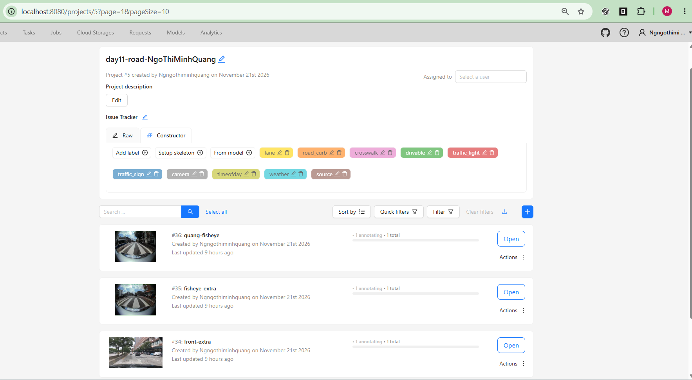
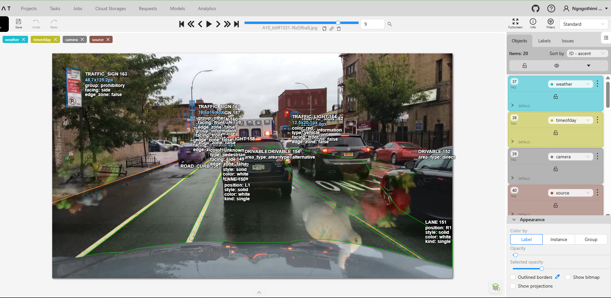
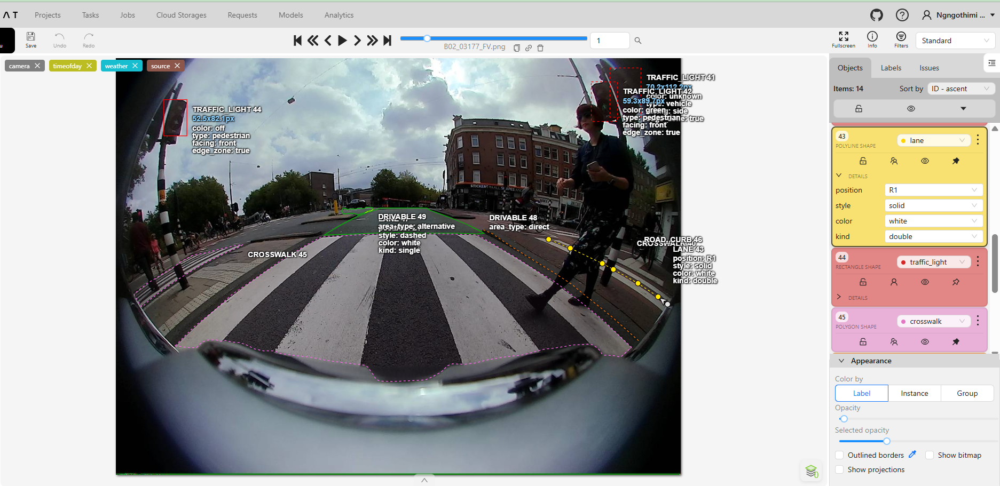
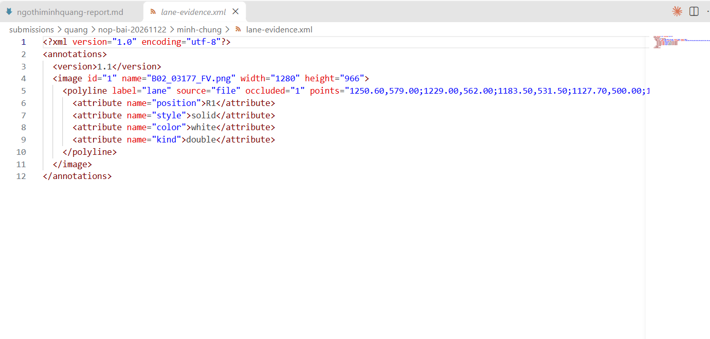

# Báo cáo cá nhân — Ngày 11: Road Elements & SVM

**Họ tên:** Ngô Thị Minh Quang  
**Mã học viên:** 2A202603146  
**Ngày lab / phiếu QC:** 20/11/2026  
**Cập nhật bộ nộp:** 22/11/2026  
**Guideline:** Road v1.0  
**CVAT:** 2.74.1 (theo hồ sơ phiên gán nhãn), http://localhost:8080.  
**Project:** day11-road-NgoThiMinhQuang, ID 5.  
**Phiên bản bộ bàn giao:** revision 2, bản sửa sau phiếu Rework.  
**Phạm vi:** 20 ảnh bắt buộc và 8 ảnh thêm; 310 shape, 112 tag.  
**Bộ nộp:** hai ZIP nhãn, manifest, Phiếu QC 1 kiểm Trại và báo cáo này. Minh chứng được lưu trong thư mục `minh-chung` đi kèm.

## 1. Kiểm project

| Mục | Kết quả | Ghi chú |
| --- | --- | --- |
| 6 label hình | lane, road_curb, crosswalk, drivable, traffic_light, traffic_sign | Kiểu polyline/polygon/box đúng trong XML |
| Thuộc tính, giá trị | Không có cảnh báo sai tên hoặc giá trị | Lint không xác nhận đúng ngữ nghĩa theo ảnh |
| 4 tag ảnh | 28/28 ảnh đủ camera, timeofday, weather, source | 112 tag, camera khớp tên ảnh, source=real |
| 4 task | front 12, front-extra 4, fisheye 8, fisheye-extra 4 | Khi bàn giao gộp thành hai ZIP front/fisheye |
| Completed / chốt CVAT | Ngoại lệ trong bộ bàn giao | Chi tiết tại mục 5; không xác minh lại job trong lần đóng gói |

Kết thúc polyline bằng N/Done sau khi đặt điểm từ gần ra xa trên tâm vệt sơn, kiểm Details rồi Save. Vạch đứt cùng một ranh giới dùng một polyline; vạch đôi dùng một đường tâm với kind=double. Mỗi tag là label riêng với thuộc tính value; kiểm lại giá trị mặc định ngay sau khi tạo.

## 2. Số lượng đã gán sau sửa

Đếm trực tiếp từ hai ZIP bàn giao, phân nhóm theo mã ảnh. Shape không bao gồm tag ảnh.

| Task | Ảnh | lane | road_curb | crosswalk | drivable | traffic_light | traffic_sign |
| --- | ---: | ---: | ---: | ---: | ---: | ---: | ---: |
| front | 12 | 41 | 4 | 10 | 29 | 24 | 33 |
| front-extra | 4 | 15 | 2 | 6 | 11 | 7 | 16 |
| fisheye | 8 | 28 | 14 | 12 | 19 | 9 | 12 |
| fisheye-extra | 4 | 4 | 3 | 5 | 6 | 0 | 0 |
| **Tổng** | **28** | **88** | **23** | **33** | **65** | **40** | **61** |

Tổng **310 shape và 112 tag**. Đủ 12/12 ảnh front và 8/8 ảnh fisheye bắt buộc; đã làm thêm 4/4 ảnh front và 4/4 ảnh fisheye. Điểm thưởng do giáo viên đánh giá.

## 3. Bảng ca khó

| Ảnh | Nhãn / phân vân | Đã chọn | Lý do / giới hạn |
| --- | --- | --- | --- |
| A05 | Thiếu L1/R1 hay không có vạch | Không thêm vạch suy đoán | Không thấy vạch sơn rõ; hai cảnh báo được ghi nhận là ngoại lệ theo xác nhận của học viên |
| A09 | R1 hay road_curb | Giữ road_curb, không thêm R1 | Còn một cảnh báo; ghi nhận ngoại lệ theo xác nhận của học viên |
| A14 | R1 khó thấy trong ảnh đêm | Không thêm R1 suy đoán | Còn một cảnh báo; ghi nhận ngoại lệ theo xác nhận của học viên |
| A09 | Hai nét hay một vạch đôi | Một tâm L2/solid/white/double | Tránh hai polyline đại diện hai mép của cùng vạch đôi |
| A14 | Màu và loại vạch | L1/yellow/double; bỏ lane ngang | Ảnh có vàng đôi; nét ngang là vạch dừng |
| A14 | drivable khoét theo xe phía trước | Đã sửa hai polygon trong bộ nộp | Bỏ các đỉnh bám thân xe/bánh xe phía trước; biên bị che được nội suy, chưa đối chiếu GT |
| A06 | Lane ngang hay vạch dừng | Bỏ lane ngang | Đổi thứ tự điểm không sửa được sai loại đối tượng |
| A10 | Vùng đường hay đường bao xe | Vẽ lại vùng liên tục, bỏ alternative thuộc dải đỗ trái | Nội suy biên mặt đường dưới xe che; chưa đối chiếu GT |
| B02 | Đường đi vòng hay đường tâm | Một polyline R1 hở gần → xa | Giữ kind=double; chưa chứng nhận độ lệch ≤5 px |
| B11 | Lane hay vạch ô đỗ/gạch chéo | Bỏ sáu lane E01–E06 | Ngoài phạm vi lane của Road v1.0 |
| B06/B08 | Mép thân xe, bóng, cạnh đảo/ray | Không sửa suy đoán | Phiếu chưa đủ căn cứ ghi thêm lỗi |

Cách xử lý cảnh báo L1/R1 và phạm vi ngoại lệ của bộ bàn giao được ghi tại mục 5. Không bổ sung vạch không thấy được chỉ để hết cảnh báo lint.

## 4. Phiếu QC 1 nhận được và phản hồi

**Người kiểm:** Bùi Kim Trại. **Ngày phiếu:** 20/11/2026.  
**Phiếu nhận:** [trai-qc1-for-ngothiminhquang.md](minh-chung/reports/qc-received/trai-qc1-for-ngothiminhquang.md).  
**Quyết định:** Rework. Mẫu A02/A08/A10/B02/B06/B08 có 118 nhãn; một lỗi nặng, năm lỗi chính, 5/118=4,24%. B11 có sáu lỗi nặng, xét riêng.

| Lỗi | Số lỗi | Đồng ý / phản hồi | Đã sửa? |
| --- | ---: | --- | --- |
| F01, QC1-03, A08 | 1 nặng | Bỏ lane#32 trên nét ngang giao lộ | Đã bỏ trong XML mới |
| F02, QC1-07, A10 | 1 chính | Không khoét direct theo xe | Đã vẽ lại biên polygon trong XML |
| F03, QC1-07, A10 | 1 chính | Không khoét alternative phải theo xe | Đã vẽ lại biên polygon trong XML |
| F04, QC1-07, A10 | 1 chính | Dải ngoài cùng trái thuộc vùng đỗ sát lề | Đã bỏ polygon dải đỗ, làm liền biên alternative còn lại |
| F05, QC1-09, A10 | 1 chính | Biển cấm dừng/đỗ thuộc prohibitory | Đã đổi group |
| F06, QC1-04, B02 | 1 chính | Thay đường vòng bằng tâm vạch đôi | Đã thay polyline hở gần → xa |
| E01–E06, QC1-03, B11 | 6 nặng, ảnh thêm | Ô đỗ/gạch chéo không gán lane | Đã bỏ sáu lane |

Ngoài phiếu nhận, tự sửa thêm: bỏ lane ngang ở A06; gộp cách biểu diễn vạch đôi A09 và A14; vẽ lại hai vùng drivable A14 qua xe phía trước. Nhật ký sửa được giữ trong [changes.json](minh-chung/changes.json). Số lỗi trong phiếu nhận là kết quả kiểm bản trước sửa, được giữ nguyên để truy vết.

**Phiếu tôi kiểm Trại:** [ngothiminhquang-qc1-for-trai.md](ngothiminhquang-qc1-for-trai.md), ngày 20/11/2026. Đủ 12 mã QC; mẫu bắt buộc 118 nhãn; một lỗi nặng và năm lỗi chính (4,24%), quyết định Rework. B11 được xét riêng. Việc sửa lô của tôi không thay đổi kết quả phiếu tôi lập cho Trại.

## 5. Kiểm file export và bàn giao

| File | Phạm vi | Mở ZIP / CRC / XML | Shape ảnh 1 (job / file) | Shape ảnh 2 (job / file) | Camera | Kèm ảnh gốc |
| --- | --- | --- | --- | --- | --- | --- |
| ngothiminhquang-front.zip | A01–A16, 16 ảnh | Hợp lệ, XML 1.1 | A01: ngoại lệ / 8 | A02: ngoại lệ / 7 | 16/16 | Không |
| ngothiminhquang-fisheye.zip | B01–B12, 12 ảnh | Hợp lệ, XML 1.1 | B01: ngoại lệ / 7 | B02: ngoại lệ / 10 | 12/12 | Không |

Hai ZIP ở định dạng CVAT for images 1.1, mỗi ZIP chỉ chứa `annotations.xml`. Đã kiểm đủ 28 ảnh không trùng, tên và kích thước khớp ảnh gốc, mỗi ảnh có đủ bốn tag. SHA-256 và số byte khớp [manifest bàn giao](ngothiminhquang-manifest.json). Không thay đổi hình vẽ hoặc thuộc tính khi đóng gói bộ nộp.

**Thời điểm tạo manifest:** `2026-11-22T01:07:20+00:00` (UTC). Đây là thời điểm đóng gói/kiểm file; thời điểm export cuối trên CVAT không được xác minh lại. Revision 2 dùng cho bản bàn giao sau Rework, không suy ra số lần đã gửi trên kênh lớp.

**Kết quả lint:** bốn cảnh báo nặng QC1-02, không có cảnh báo chính/nhẹ: A05 thiếu L1 và R1; A09 thiếu R1; A14 thiếu R1. Log đầy đủ: [lint.txt](minh-chung/lint.txt). Lint kiểm định dạng và một số quy tắc, không chấm độ sát hình hoặc nhãn bỏ sót theo GT.

**Ngoại lệ được học viên xác nhận ngày 22/11/2026:**

1. Giữ nguyên nhãn ở A05/A09/A14 và ghi nhận bốn cảnh báo QC1-02 trên là ngoại lệ; không thêm vạch suy đoán. Manifest vẫn phản ánh đúng bốn cảnh báo.
2. Bước chốt nhãn trên CVAT và kiểm lại sau sửa, gồm đối chiếu job/file, completed và export lại, được ghi nhận là ngoại lệ. Vì vậy cột số shape trên job ghi “ngoại lệ”, không điền số chưa kiểm chứng.

Chi tiết lưu trong [ghi nhận ngoại lệ](minh-chung/ngoai-le.md). Đây là xác nhận của học viên trong quá trình hoàn thiện hồ sơ; chưa có xác nhận riêng của coach cho từng cảnh báo hoặc quyết định Release mới của người kiểm trong hồ sơ.

**Kiểm công cụ ngày 22/11/2026:** chạy lại bộ test, **31/31 test đạt**; `road_check selftest` in **SELFTEST PASS** trên dữ liệu tổng hợp. Đã kiểm ZIP/CRC/XML, SHA-256, số lượng nhãn, trích đoạn XML, ảnh minh chứng và toàn bộ liên kết Markdown trong bộ nộp. Không dùng selftest để suy ra điểm chất lượng nhãn. Kết quả rà soát: [verification.json](minh-chung/verification.json).

## 6. Ảnh chụp và bằng chứng

Bốn ảnh dưới đây do học viên cung cấp khi hoàn thiện báo cáo ngày 22/11/2026.

### 6.1. Labels của project



Ảnh thể hiện tên project, sáu label hình (lane, road_curb, crosswalk, drivable, traffic_light, traffic_sign) và bốn label tag (camera, timeofday, weather, source).

### 6.2. Ảnh camera trước A10



Ảnh cho thấy các đường lane, vùng drivable, road_curb, hộp đèn/biển và bốn tag. Biển NO PARKING / NO STANDING hiển thị group=prohibitory, minh họa việc sửa F05. Các tag đang thu gọn nên ảnh không chứng minh giá trị của từng tag; giá trị được kiểm từ XML bàn giao.

### 6.3. Ảnh fisheye B02



Polyline được chọn có các điểm bám theo cung và bảng thuộc tính position=R1, style=solid, color=white, kind=double. Ảnh minh họa cách biểu diễn một đường tâm hở cho vạch đôi; không tự suy ra độ lệch so với GT từ ảnh chụp.

### 6.4. XML của bộ nộp



Ảnh chụp trình soạn thảo hiển thị tên ảnh B02, thẻ polyline label="lane", các tọa độ và bốn thuộc tính. Tệp trích đoạn được lấy từ ZIP bàn giao: [lane-evidence.xml](minh-chung/lane-evidence.xml).

Ảnh CVAT minh họa nhãn đang hiển thị, không thay thế việc đối chiếu toàn bộ job với ZIP. Các ngoại lệ của bộ bàn giao vẫn được giữ theo mục 5.

Đoạn XML thực tế của R1 ở B02 sau sửa, khớp ZIP fisheye cuối:

```xml
<?xml version="1.0" encoding="utf-8"?>
<annotations>
  <version>1.1</version>
  <image id="1" name="B02_03177_FV.png" width="1280" height="966">
    <polyline label="lane" source="file" occluded="1" points="1250.60,579.00;1229.00,562.00;1183.50,531.50;1127.70,500.00;1102.60,486.40;1030.10,451.80;981.00,431.70" z_order="0">
      <attribute name="position">R1</attribute>
      <attribute name="style">solid</attribute>
      <attribute name="color">white</attribute>
      <attribute name="kind">double</attribute>
    </polyline>
  </image>
</annotations>
```

Trích đoạn văn bản trên đi kèm ảnh chụp XML ở mục 6.4 để đối chiếu.

## 7. Tự đánh giá

Nhóm lỗi lặp lại nhiều nhất trong mẫu QC là **QC1-07: sai phạm vi vùng lái**, với ba polygon ở A10 khoét theo xe. Tôi đã sửa biên để biểu diễn phần đường đi được khi đường trống và loại dải đỗ sát lề khỏi phạm vi làn chạy. Tôi cũng sửa lỗi QC1-03 (gán vạch ngang/ô đỗ thành lane), QC1-04 (polyline đi vòng theo hai mép) và QC1-09 (sai nhóm biển cấm).

Để tránh lặp lại ở Ngày 20, tôi sẽ xác định loại đối tượng trước khi vẽ; kiểm thuộc tính mặc định ngay sau khi tạo; rà theo thứ tự tag → lane → vùng lái → đèn/biển. Với lane, kiểm đường tâm, chiều gần → xa, vạch đứt liền một polyline và cờ occluded khi nối qua chỗ che. Với drivable, phân biệt đường, dải đỗ và thân xe mình, rồi kiểm biên dưới các xe che khuất.

Nhãn lane cung cấp đường tâm và thuộc tính để tạo đích huấn luyện nhận diện làn, chẳng hạn tọa độ x tại các hàng neo. Một polyline đi vòng có thể tạo nhiều giao điểm trên cùng hàng, làm đích không nhất quán. Gán vạch ô đỗ thành lane khiến mô hình học nhầm đối tượng. Nhãn drivable tạo vùng đích cho phân đoạn mặt đường; nếu khoét theo xe, mô hình có thể học hình bóng xe thay vì khả năng đi được của mặt đường. Sửa các lỗi này giúp đích huấn luyện phù hợp hơn với guideline; mức độ khớp GT vẫn do giáo viên đánh giá.

## 8. Tùy chọn: từ polyline đến row-anchor

Đối chiếu R1 của A01 từ hai bộ ZIP bằng lệnh rowanchor. Đây là kết quả tính từ file, không phải buổi thảo luận trực tiếp với bạn.

| y | 720 | 680 | 640 | 600 | 560 |
| --- | ---: | ---: | ---: | ---: | ---: |
| x của Quang | Không có làn | Không có làn | 600,9 | 542,7 | 485,4 |
| x trong file Trại | Không có làn | Không có làn | 600,9 | 542,7 | 485,4 |

Nội suy x=x1+(x2−x1)(y−y1)/(y2−y1). Đầu gần của vạch hiện ở y≈679, nên hàng 680/720 ngoài phạm vi, không ngoại suy. Nếu cắt đầu gần thêm 40 px theo trục y, đầu gần về y≈639 và hàng 640 cũng mất đích làn.

Ở y=560, hai file lệch 0,0 px; ở y=720 đều không có làn nên không tính được chênh lệch pixel. Sai số vùng gần xe thường ảnh hưởng trực tiếp tới ước lượng vị trí ngang khi giữ làn; không dùng cặp giá trị thiếu để kết luận chất lượng bằng nhau.

Đảo điểm không đổi nội suy trên cùng đoạn hình học, nhưng vi phạm chiều gần → xa và ảnh hưởng xử lý lấy điểm đầu. road_check lint kiểm quy tắc này. Row-anchor giống nhau không chứng minh toàn bộ nhãn hai lô đều đúng.
